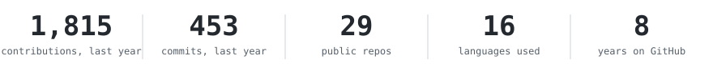
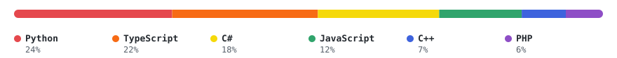

<h1 align="center">Ömer Dikyol</h1>

Software engineer & researcher in Istanbul, Turkey. 
3+ years across backend systems, applied AI and telecom. 
M.Sc. Computer Engineering at Istanbul Technical University.

<h3 align="center">Live</h3>

<a href="https://netmeter.omerdikyol.com/">NetMeter</a>: macOS menu-bar network monitor; the site runs its real panel on sample traffic 
<a href="https://ituscheduler.omerdikyol.com/">ITU Scheduler</a>: course planner for ITU students with conflict checks 
<a href="https://omerdikyol.github.io/rayda/">Rayda</a>: Marmaray map with timetable-based train simulation 
<a href="https://omerdikyol.github.io/voice-ai-dashboard/">Voice AI Dashboard</a>: call analytics and prompt-assembly console 
<a href="https://jobtrack.omerdikyol.com/">jobtrack</a>: local job-search workspace built from Gmail 
<a href="https://omerdikyol.github.io/sentiment-analysis-of-individual/">Sentiment dashboard</a>: sentiment tracking across news and social posts 
<a href="https://omerdikyol.github.io/PaySub/">PaySub</a>: subscriptions and recurring-expense tracker (Expo web build)

Where a project is a demo, it runs in the browser on mock data. Nothing in those is real.

<a href="https://omerdikyol.com">website</a> ·
<a href="https://www.linkedin.com/in/omerdikyol">linkedin</a> ·
<a href="https://x.com/omercodes">x</a> ·
<a href="mailto:omerdikyol02@gmail.com">email</a>

open to work

